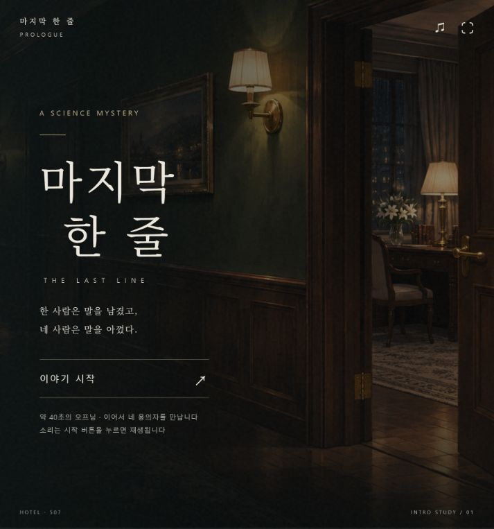

# 과학 미스터리 게임

React + TypeScript + Vite로 제작하는 2D 추리 게임의 **인트로 프로토타입**입니다. 가제는 《마지막 한 줄》이며, 현재는 호텔 사건 소개와 네 용의자의 첫 진술까지 구현했습니다.



## 실행

VS Code에서 **이 README가 있는 최상위 폴더**를 열고 터미널에서 실행합니다.

```powershell
npm ci
npm run dev
```

브라우저에서 <http://localhost:5173>에 접속합니다. 실행 중에는 터미널을 켜 두고, 종료할 때는 `Ctrl+C`를 누릅니다.

의존성 설치는 처음 내려받았거나 잠금 파일이 바뀌었을 때 필요합니다. PowerShell에서 `npm.ps1` 실행이 차단되는 경우 `npm.cmd`를 사용할 수 있습니다. 5173 포트를 이미 사용 중이라면 기존 서버에 접속하거나 `npm run dev -- --port 5174`로 다른 포트를 지정합니다.

## 폴더

```text
src/          현재 React 소스와 이미지
scripts/      단독 HTML 생성 도구
tests/        인트로 진행 규칙 테스트
docs/         현재 구조와 개발 안내
exports/      더블클릭용 HTML (빌드 시 생성)
dist/         웹 배포 파일 (빌드 시 생성)
```

자주 수정하는 파일은 다음과 같습니다.

- [전체 인트로 구성](src/intro/HotelIntro.tsx)
- [인물·대사·장면 시간표](src/intro/content.ts)
- [화면 컴포넌트](src/intro/components/)
- [색상·배치·애니메이션](src/intro/intro.css)
- [폴더와 코드 읽는 순서](docs/project-structure.md)

## 명령어

| 명령어                 | 기능                               |
| ---------------------- | ---------------------------------- |
| `npm run dev`          | 개발 서버                          |
| `npm test`             | 진행 규칙 테스트                   |
| `npm run check`        | TypeScript 검사                    |
| `npm run format`       | 들여쓰기·줄바꿈 정리               |
| `npm run format:check` | 코드 포맷 검사                     |
| `npm run build`        | 타입 검사·배포 빌드·단독 HTML 생성 |
| `npm run preview`      | 빌드 결과 미리보기                 |

단독 실행 파일은 빌드 후 `exports/호텔사건-React인트로.html`에 생성됩니다. 개발할 때는 `src`를 수정하고, `dist`나 단독 HTML을 직접 편집하지 않습니다. 생성 파일은 용량을 줄이기 위해 압축될 수 있습니다.

## 실행 환경

Node **24.22.1**에서 실행·빌드를 검증했습니다 (`.node-version`). Node 버전 관리 도구를 사용한다면 이 버전에 맞춰 설치하세요.

## 현재 범위

40초 사건 소개, 아내·아들·비서·청소부의 진술, 환경음, 일시정지, 건너뛰기, 다시 보기를 지원합니다. 호텔 사건의 과학 단서·범인·전체 시나리오는 아직 확정 전이며, Express·MySQL·랭킹은 아직 구현하지 않았습니다.

배경과 인물 이미지는 ImageGen으로 생성했으며 [생성 프롬프트](docs/image-prompts.json)를 함께 제공합니다. 환경음은 Web Audio로 합성합니다.

이전 시안·교과서 PDF 및 추출 자료·로컬 백업은 저장소에 포함하지 않습니다. `node_modules`, `dist`, `exports`도 제외하며 설치와 빌드 명령으로 생성합니다.
